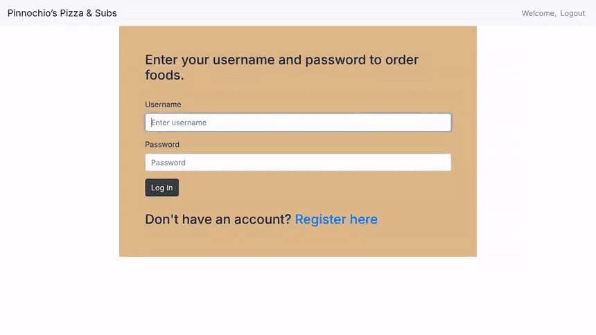

# Pinocchio's Pizza & Subs

An online ordering site for a pizza restaurant, built with Python and Django. Customers create an account, pick items from the menu (pizzas with toppings, subs, pasta, salads and dinner platters), and place an order. Staff members see every customer's order and confirm them. This was Project 3 of Harvard's CS50 Web Programming with Python and JavaScript course; the menu is based on Pinocchio's Pizza & Subs in Cambridge, Massachusetts.



The demo was recorded on a local copy with sample accounts. An earlier video walkthrough is also on [YouTube](https://youtu.be/NWBRqYktIMs).

## Features

- **Accounts:** register with first name, last name, email, username and password, then log in. The menu is only shown to logged-in users.
- **Full menu:** regular and Sicilian pizzas (small and large), subs, pasta, salads and dinner platters, each with its own prices.
- **Toppings:** clicking a pizza price unlocks the toppings checkboxes. A 1-, 2- or 3-topping pizza is added to the cart as soon as you tick that many toppings; a "Special" allows five; a cheese pizza is added straight away.
- **Shopping cart:** every item you add is listed with its toppings and price, along with a running total.
- **Placing an order:** "Place Order" shows a summary page, and "Confirm Order" marks the cart items as **pending**.
- **Staff view:** users with Django's staff flag get a "Customer Orders" link listing every order. Confirming an order changes its status in the customer's cart to **approved**.
- **Menu management:** the menu is stored in the database and can be edited in the Django admin at `/admin`.

## How it works

1. Each menu section is its own Django model (`RegularPizza`, `SicilianPizza`, `Toppings`, `Subs`, `Pasta`, `Salads`, `DinnerPlatters`). The index view loads all of them into one menu page.
2. `main.js` controls the toppings checkboxes. The pizza's name tells it how many toppings are allowed; once that many are ticked, it sends the browser to `/order/<item>/<price>/<toppings>/`.
3. The `order` view saves the item as a `ShoppingCart` row for the logged-in user and goes back to the menu.
4. Confirming an order sets the user's cart rows to `pending`. The staff page lists all cart rows, and approving one sets it to `approved`.

## Project structure

```
pizza/                    Django project settings and URLs
orders/                   The app
├── models.py             Menu models and the ShoppingCart model
├── views.py              Menu, accounts, cart, order confirmation and staff views
├── urls.py               URL routes
├── admin.py              Registers the menu models in the Django admin
├── templates/orders/     base, login, register, index (menu), confirm and staff pages
└── static/orders/
    ├── main.js           Toppings selection logic
    └── styles.css
db.sqlite3                SQLite database with the menu already loaded
requirements.txt          Django 2.0.3
```

## Running it locally

The app pins Django 2.0.3, so use **Python 3.8** (newer Python versions are not supported by Django 2.0).

```bash
python3.8 -m venv venv
source venv/bin/activate
pip install -r requirements.txt
python manage.py migrate
python manage.py createsuperuser   # this account can see and confirm orders
python manage.py runserver
```

Then open http://127.0.0.1:8000 and register a customer account. The included `db.sqlite3` already contains the menu. Log in with the superuser account to see the "Customer Orders" page, or go to http://127.0.0.1:8000/admin to edit the menu.

The pages load Bootstrap and jQuery from public CDNs, so the styling and the toppings selection need an internet connection.

## Built with

- **Backend:** Python, Django 2.0, SQLite
- **Frontend:** HTML, CSS, Bootstrap 4, JavaScript and jQuery

## Course credit

This project was built for [CS50's Web Programming with Python and JavaScript](https://cs50.harvard.edu/web/) from Harvard University. The task was to build an ordering site for Pinocchio's Pizza & Subs using its real menu.

Created by Sangye Tenphel, 2020.
